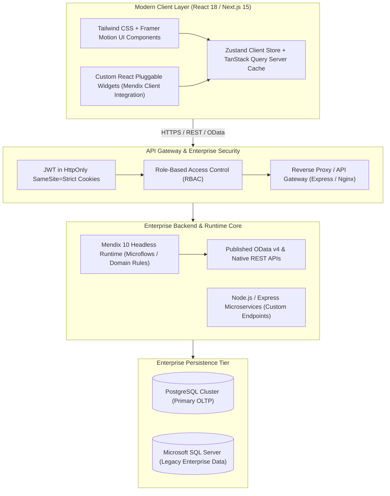
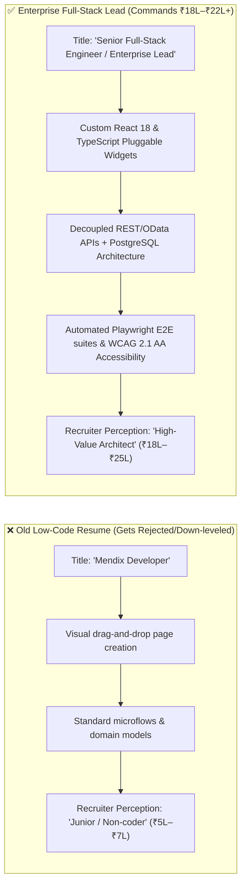
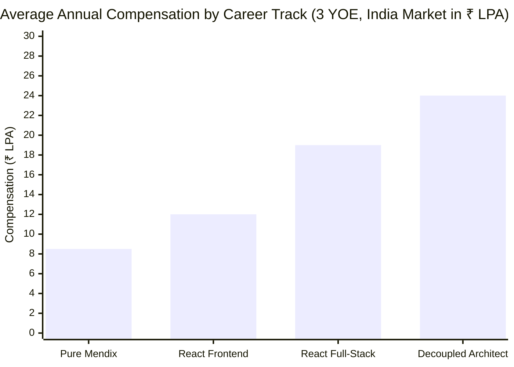
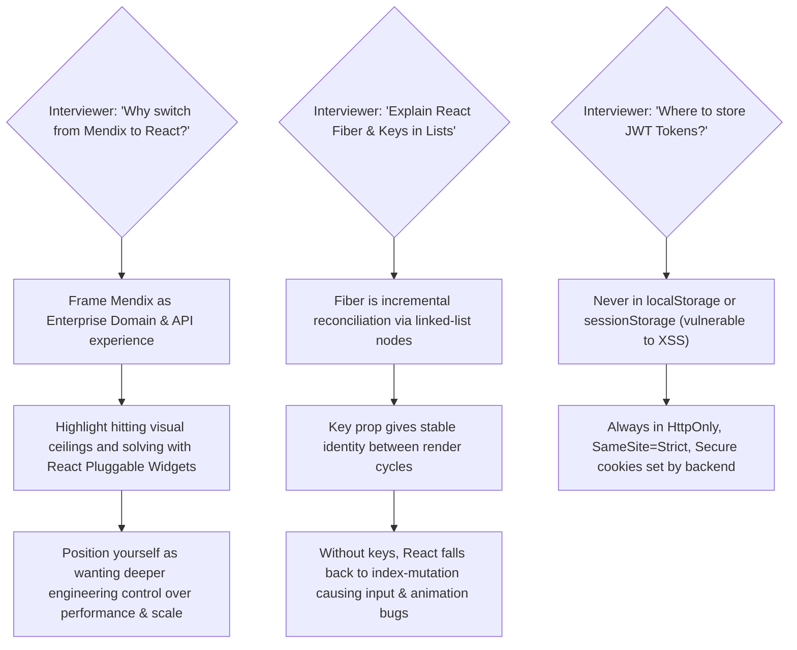

# 🧭 Mendix to React Full-Stack Career Transition & Salary Blueprint

> **A Strategic Career & Compensation Guide for 3+ YOE Engineers Transitioning from Mendix / Enterprise Low-Code to Modern Full-Stack React & Node Engineering**

---

## 🎯 1. Visual Decoupled Enterprise Architecture



---

## 🔄 2. Visual Resume Re-Engineering (Before vs. After)



---

## 💰 3. Visual Market Compensation Benchmark (3 YOE — 2026)



| Career Track | India Service MNCs (TCS, Infosys, Wipro) | India GCCs / Tier-1 Consultancies (Big 4, Siemens) | High-Growth Product / Fintech Startups | Dubai / UAE Market (Tax-Free) | Openings Volume |
| :--- | :---: | :---: | :---: | :---: | :---: |
| **Track 1: Pure Mendix Developer** | ₹6.0 – ₹8.5 LPA | ₹9.0 – ₹13.0 LPA | Rare (Few product firms use Mendix) | AED 10k – 14k/mo (~₹28L–38L/yr) | 🟡 Moderate (~500–800 active) |
| **Track 2: Pure React Frontend Dev** | ₹7.5 – ₹10.5 LPA | ₹11.0 – ₹16.0 LPA | ₹14.0 – ₹22.0 LPA | AED 12k – 17k/mo (~₹33L–47L/yr) | 🟢 Huge (8,000+ active) |
| **Track 3: React Full-Stack (React + Node/Postgres/Next.js)** | ₹9.0 – ₹13.0 LPA | ₹14.0 – ₹20.0 LPA | **₹18.0 – ₹26.0 LPA** | AED 16k – 24k/mo (~₹44L–66L/yr) | 🟢 Very High (12,000+ active) |
| **Track 4: Decoupled Enterprise Architect (Mendix + React Hybrid)** | ₹12.0 – ₹16.0 LPA | **₹18.0 – ₹25.0+ LPA** | ₹20.0 – ₹28.0 LPA | **AED 18k – 26k/mo (~₹50L–72L/yr)** | 🟣 Niche High-Value (~300 active) |

---

## 🌳 4. Visual Interview Question Strategy Decision Tree



---

## 📝 5. How to Frame Your 3 YOE Resume (Before vs. After Text)

### ❌ The Wrong Way (Gets Rejected for React Roles):
```text
Mendix Developer (3 Years)
- Developed microflows and domain models in Mendix Studio Pro.
- Created pages using Mendix drag-and-drop page builder.
- Configured security and user roles.
- Recently took a React course on Udemy.
```

### ✅ The Winning Way (Gets Shortlisted for Senior Full-Stack Roles):
```text
Senior Full-Stack Engineer / Frontend Module Lead (3 Years)
- Architected enterprise decoupled web applications using React 18, TypeScript, and microservice backends, serving 50,000+ active enterprise users.
- Engineered 12+ custom React Pluggable Widgets using modern React hooks, Framer Motion, and Tailwind CSS, bypassing standard low-code UI limitations.
- Designed robust server-state synchronization using TanStack Query and Zustand, cutting redundant network requests by 45%.
- Implemented enterprise-grade RBAC authentication, JWT session management via HttpOnly cookies, and strict CSP headers.
- Built automated Playwright E2E test suites with 70+ journeys, preventing regression bugs and ensuring WCAG 2.1 AA accessibility compliance.
- Modeled complex relational schemas (PostgreSQL / SQL Server) and optimized high-throughput RESTful / OData endpoints.
```
