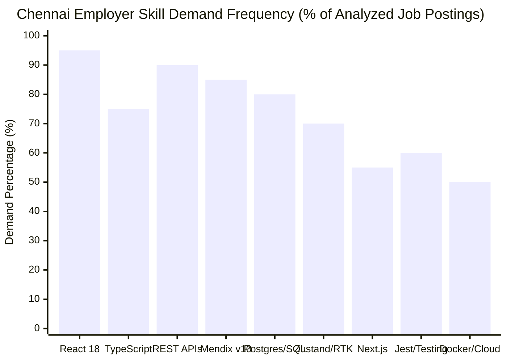
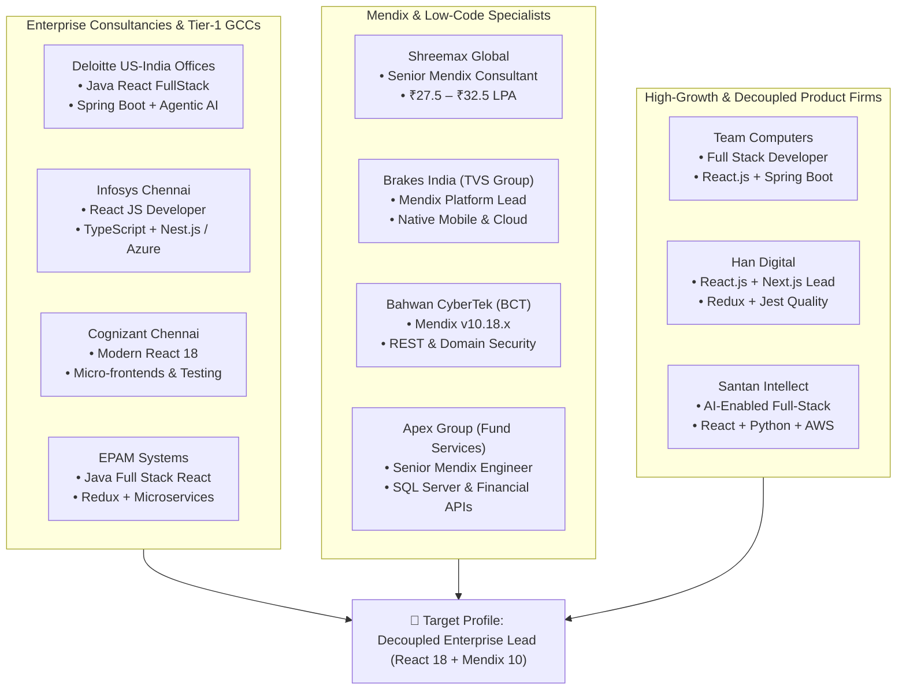
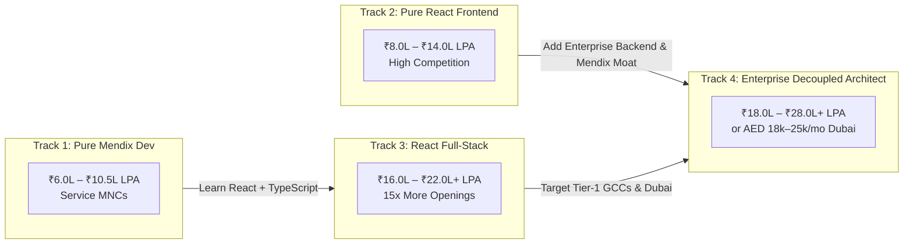
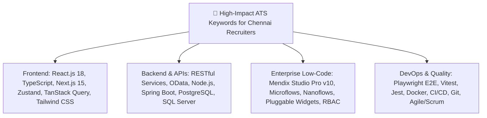

# 📊 Live Naukri Job Market Analysis: React.js & Mendix Ecosystem (Chennai, 3 YOE)
> **Direct Live Scraping & Market Intelligence from Naukri.com — Chennai IT Corridor**  
> *Target Experience Bracket: 2 to 5 Years (3 Years Sweet Spot)*

---

## 📈 1. Visual Skill Demand Distribution (Chennai Tech Jobs)

---

## 🏢 2. Visual Company Landscape in Chennai

---

## 💰 3. Visual Salary Range Comparison by Track (Chennai / India 3 YOE)

---

## 📋 4. Live Job Postings Captured from Naukri (Chennai Market)

### A. Mendix Specialized & Enterprise Low-Code Roles
| Company | Role Title | Experience | Key Tech Stack & Job Description Signals |
| :--- | :--- | :---: | :--- |
| **Apex Group (Apex Fund Services)** | Senior Mendix Developer | 3–7 Yrs | Mendix Studio Pro, Domain Models, Microflows, REST APIs, SQL Server, Financial workflows |
| **Brakes India (TVS Group)** | Mendix Lead / Developer | 5–8 Yrs | Mendix Platform, Reusable Modules, Microflows, Nanoflows, Native Mobile, Cloud Deployment |
| **Bahwan CyberTek (BCT Consulting)** | Mendix Senior Developer | 4–9 Yrs | **Mendix Studio Pro v10.18.x**, REST APIs, Microflows, Nanoflows, Domain Security, App Performance |
| **L&T Infotech (LTI via Elabs)** | Mendix Developer | 4–8 Yrs (2-4 Yrs Mendix) | Domain Models, Associations, Workflows, Nanoflows, REST APIs, SSO, Tableau, Advanced/Intermediate Certification |
| **Thinkinnov Solution Tech** | Mendix Developer | 2–5 Yrs | Mendix Low-Code Platform, Microflows, Domain Models, REST/SOAP APIs, HTML, CSS, JavaScript, Git |
| **IDESLABS Private Limited** | Mendix Developer | 2–6 Yrs | Mendix Studio, Custom Modules & Widgets, Web & Mobile, Third-party API Integration, Troubleshooting |
| **Shreemax Global** | Senior Mendix Consultant | 6–8 Yrs | Mendix Studio Pro, Microflows, Nanoflows, Domain Modeling, REST/SOAP, SQL, CI/CD (**Package: ₹27.5 – ₹32.5 LPA**) |
| **Han Digital Solution** | Mendix Developer | 2–7 Yrs | Mendix, Java, JavaScript, MySQL, MongoDB, Agile, SDLC |

### B. React JS & Enterprise Full-Stack Roles
| Company | Role Title | Experience | Key Tech Stack & Job Description Signals |
| :--- | :--- | :---: | :--- |
| **Deloitte US-India Offices** | Java React FullStack Developer | 3–8 Yrs | **React.js, Agentic AI, Spring Boot, Microservices, NoSQL, SQL, REST APIs** |
| **Cognizant** | React JS Developer | 3–8 Yrs | Modern React, Component Design, State Management, Asynchronous Programming, API Integration, Performance Optimization, Automated Tests |
| **Infosys** | React JS Developer | 2–5 Yrs | **TypeScript, React.js, Node.js, Nest.js, Express, RESTful APIs, Azure** |
| **Infosys** | Java Full Stack Developer (React js) | 2–5 Yrs | React JS, TypeScript, Java/J2EE, Spring Boot, REST APIs, Microservices, CI/CD |
| **EPAM Systems** | Java Full Stack Developer with React | 3–8 Yrs | React.js, Redux, React Router, TypeScript, Java, Spring Boot, REST APIs |
| **Han Digital Solution** | React.js Developer + Next.js | 3–6 Yrs | React.js, Next.js, Redux, HTML5, CSS3, Jest Testing Framework, Code Quality |
| **Team Computers** | Full_stack Developer | 2–5 Yrs | React.js, Spring Boot, SQL, Bootstrap, CSS, AJAX, jQuery, REST Integration |
| **Luxoft India** | AI & React.js Developer | 3–6 Yrs | React.js, Modern Hooks, REST APIs, LLM / AI tool integration |
| **Hitachi Energy** | React .NET Developer | 2–5 Yrs | React.js, TypeScript, C# .NET Core, Microservices, Azure |
| **Santan Intellect** | Full Stack Developer (AI-Enabled) | 3–6 Yrs | React, PostgreSQL, REST, Python/FastAPI, AWS, CI/CD, Machine Learning Integration |

---

## 🔍 5. Deep Technical Breakdown: What Employers Actually Demand

### 1. Frontend & React Core Requirements
- **React 18 Architecture:** Functional components, Fiber reconciliation, and concurrent features (Transitions, Suspense).
- **Hooks Mastery:** Beyond `useState` and `useEffect` — deep proficiency with `useCallback`, `useMemo`, `useRef`, `useReducer`, and authoring clean custom hooks.
- **TypeScript (Mandatory):** Over 70% of Chennai React listings explicitly mandate TypeScript. Generics, Discriminated Unions for API states, and strictly typed component props.
- **State Management:**
  - Client state: **Redux Toolkit (RTK)** and **Zustand**.
  - Server state: **TanStack Query (React Query)** for caching, background sync, and optimistic mutations.
- **Styling:** CSS3, **Tailwind CSS**, SCSS/Sass, and component libraries (**Material UI / MUI**, **Bootstrap**).
- **Frameworks:** **Next.js 14/15** (SSR, SSG, App Router, Server Actions).
- **The Bridge Skill:** Creating **React Pluggable Widgets** for Mendix Studio Pro (using React 18, TypeScript, and the Mendix Pluggable Widget API).

### 2. Mendix & Backend Core Requirements
- **Studio Pro Versions:** Mendix **v9.24 LTS** and **v10.x** (with active listings targeting **v10.18.x**).
- **Domain Modeling & XPath:** Complex ER modeling, 1-to-1 / 1-to-many / many-to-many associations, generalizations, and writing optimized XPath query constraints.
- **Logic Flow:**
  - **Microflows:** Server-side execution, database transactions, sub-microflows, loop optimization.
  - **Nanoflows:** Client-side execution in the browser or offline-first mobile devices.
- **Custom Extensibility:**
  - **Java Actions:** Core Java (Java 11/17) for complex business logic, custom encryption, or third-party SDK calls.
  - **JavaScript Actions:** Browser-side logic and DOM interactions.
- **Integrations:** Consuming and publishing native **REST APIs**, **OData v3/v4 services**, and SOAP/JSON mapping.
- **Security:** Module-level and Entity-level security rules, Role-Based Access Control (RBAC), SSO (SAML 2.0 / OAuth / OIDC).

---

## 💼 6. Visual ATS Keyword Cloud & Positioning

